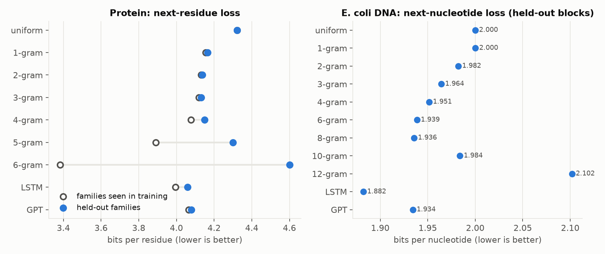
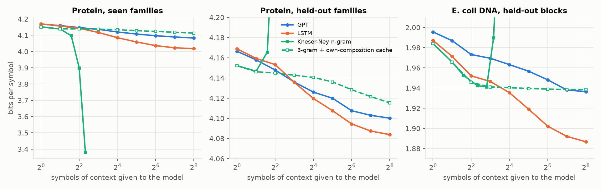
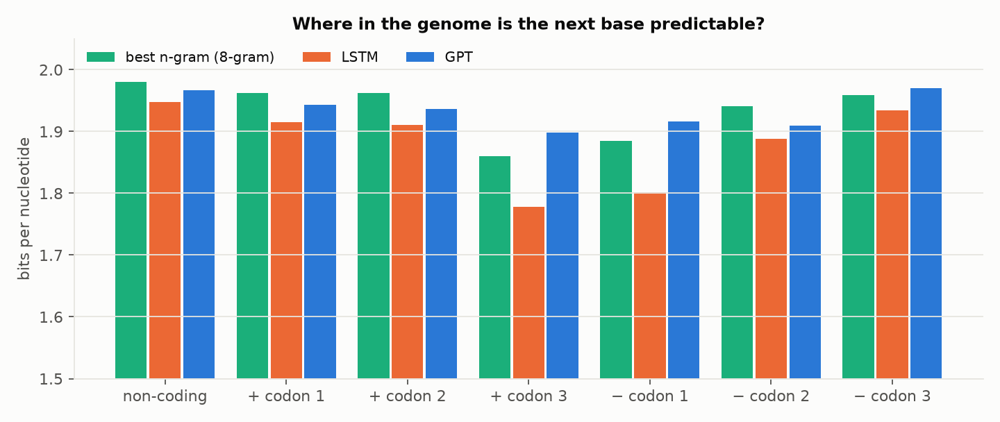
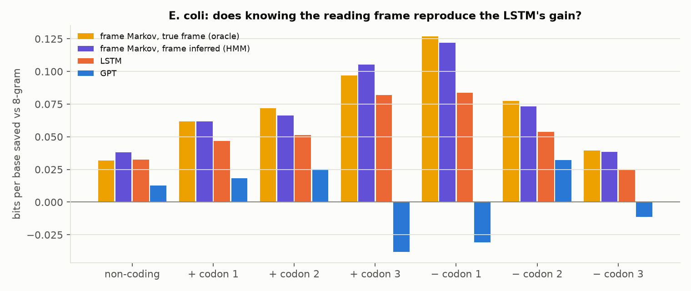
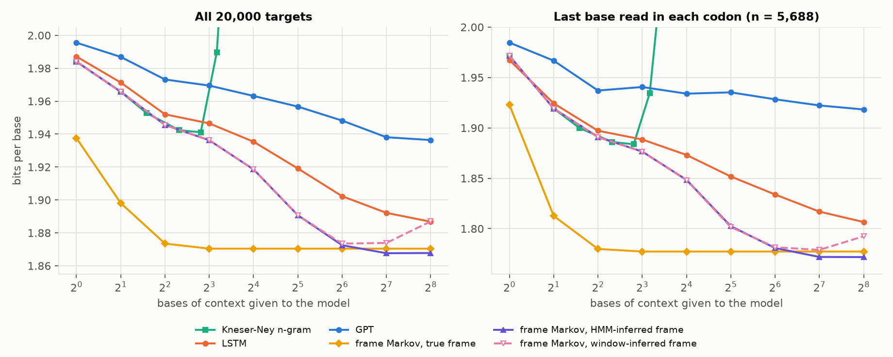
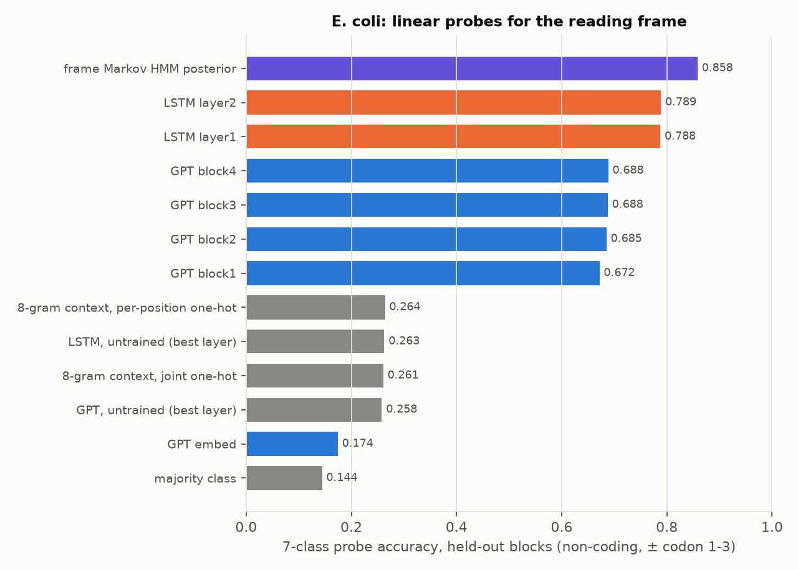
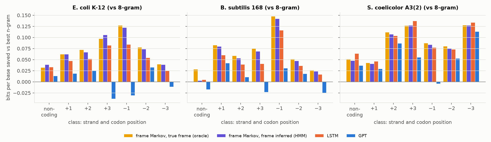
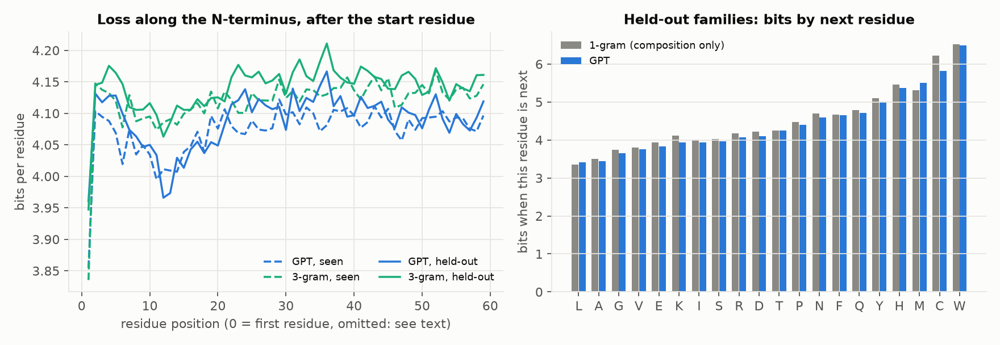

# next-token-bio

[](https://github.com/aarnavbhat23/next-token-bio/actions/workflows/tests.yml)

When a language model "predicts the next amino acid" or "the next nucleotide", how much of that is biological grammar, and how much is recognising a close relative from the training set?

This repository trains next-token predictors from scratch on **269k Swiss-Prot proteins** and the **E. coli K-12 genome**: a Kneser-Ney n-gram ladder, a 2.0M-parameter LSTM and a 1.9M-parameter GPT, with GPT and LSTM given identical token budgets. Every model is scored on the same positions in two kinds of test protein: **new members of families seen in training**, and **790 whole families never seen in training**. The genome is evaluated on held-out 50 kb blocks, with each base labelled as non-coding or by its codon position.



## What happened

Bits per symbol, lower is better. Uniform guessing scores 4.322 over amino acids and 2.000 over bases.

| model | protein, seen families | protein, held-out families | E. coli DNA, held-out blocks |
|---|---:|---:|---:|
| 1-gram (composition only) | 4.156 | 4.166 | 2.000 |
| best Kneser-Ney n-gram | **3.383** (6-gram) | 4.132 (3-gram) | 1.936 (8-gram) |
| GPT, 1.9M | 4.066 | 4.079 | 1.934 |
| LSTM, 2.0M | 3.995 | **4.059** | **1.882** |

Top-1 accuracy on held-out families is 9.6% for composition alone, 11.7% for the GPT and 12.3% for the LSTM. A seen-family 6-gram reaches 30.6%.

1. **Most apparent protein predictability is memorised homology.** On families seen in training, a 6-gram that simply looks up the previous five residues beats both neural models by more than 0.6 bits. On held-out families the same 6-gram is *worse than uniform guessing* (4.601 bits). The neural models are much less exposed to this: 3.995 vs 4.059 bits for the LSTM.
2. **On unseen families, next-residue prediction is close to the composition floor.** The best model gains 0.107 bits over composition alone, 2.6% of the entropy, which fits the classic finding that protein sequence is nearly incompressible. Per residue, the largest gain is for cysteine (6.23 → 5.82 bits for the GPT), consistent with cysteines occurring in pairs and motifs. The start residue is almost always Met, at about 0.3 bits.
3. **About half of the neural models' long-context gain on proteins is the protein's own composition.** See the composition control below.
4. **In DNA, the predictable base is the last one read in each codon.** The LSTM beats the best n-gram most at exactly those positions, which an 8-gram cannot locate without knowing the reading frame.



### How much context does each model use?

Each model predicts the same 20,000 held-out targets from only the last *k* symbols; every target has at least 256 symbols of true context. The n-gram is best at 2 residues of protein context and 7 bases of DNA context, then overfits. Both neural models keep improving out to 256.

**Composition control.** A long context could help simply by revealing what kind of protein this is: membrane proteins are hydrophobic throughout, disordered ones rich in S, P, E and K. To test this, the 3-gram (8-gram for DNA) is linearly mixed with a smoothed count of residues in the same *k*-symbol window. The mixing weight and smoothing are tuned per *k* on the **validation** families, then scored on the test targets (dashed line).

| at k = 256 | n-gram alone | + own-composition cache | GPT | LSTM |
|---|---:|---:|---:|---:|
| protein, held-out families | 4.147 | 4.115 | 4.100 | 4.084 |
| E. coli DNA | 1.941 | 1.938 | 1.936 | 1.887 |

For held-out proteins, composition recovers 0.031 of the LSTM's 0.063-bit advantage over the 3-gram. The other ~0.03 bits is something per-protein composition does not explain. These numbers are on positions 256 and beyond, which is why they differ from the full-sequence table. For DNA, composition explains almost none of the LSTM's gain.



### Codon position in E. coli

| bits/nt | non-coding | + codon 1 | + codon 2 | + codon 3 | − codon 1 | − codon 2 | − codon 3 |
|---|---:|---:|---:|---:|---:|---:|---:|
| best n-gram (8-gram) | 1.980 | 1.962 | 1.962 | 1.860 | 1.885 | 1.941 | 1.959 |
| LSTM | 1.947 | 1.915 | 1.911 | **1.778** | **1.801** | 1.888 | 1.934 |
| GPT | 1.967 | 1.944 | 1.937 | 1.898 | 1.916 | 1.909 | 1.970 |

The genome is always read 5′→3′ on the + strand. For + strand genes the most predictable base is codon position 3: after two bases of a codon, codon-usage bias narrows the third. For − strand genes the forward reading traverses each codon backwards, so the most predictable base is **codon position 1**, the one read last. The LSTM's advantage over the 8-gram is largest exactly there (0.08 bits, against 0.03 in non-coding DNA). This is the three-base periodicity GeneMark-style gene finders exploit; here a model trained only to predict the next base picks it up, and so it finds part of the reading-frame signal unsupervised.

### Is the DNA gain reading-frame inference?

The paragraph above reads the LSTM's codon-position gain as unsupervised reading-frame inference. Three tests check that reading: a frame-aware baseline, linear probes of the hidden states, and two more genomes. **Short answer: yes.** In all three genomes tested, knowing the frame accounts for all of the LSTM's advantage over the 8-gram. The LSTM's hidden state encodes the frame, and its gain sits at the bases where the frame is encoded. An explicit frame model with 5 bases of context does the same job better in *E. coli* and *B. subtilis* and ties the LSTM in the high-GC *S. coelicolor*.

**A frame-aware baseline.** GeneMark (Borodovsky & McIninch, *Computers & Chemistry* 1993) models coding DNA as an inhomogeneous, three-periodic Markov chain: the distribution of a base given the five before it depends on the base's codon position. Here each annotation class gets its own order-5 Kneser-Ney table: non-coding, + and − strand codon positions 1–3, and the 0.4% of bases in two overlapping genes. The tables are counted on the n-grams' training stream (both strands) and hold 8 × 4⁵ contexts, against the LSTM's 2.0M weights. The model scores the same 447,696 held-out bases in three ways:

* **true frame**: the target's class is read from the annotation (an oracle);
* **frame inferred, HMM**: forward filtering in a hidden Markov model over the classes, as in GeneMark.hmm (Lukashin & Borodovsky, *Nucleic Acids Research* 1998). Gene-start, gene-end and phase transitions are counted on the training labels. It sees exactly the context windows the neural models see, 256–511 bases;
* **frame inferred, window**: a posterior over the 7 classes from the preceding 256 bases, assuming the whole window is in one class.

| bits/nt | non-coding | + codon 1 | + codon 2 | + codon 3 | − codon 1 | − codon 2 | − codon 3 | all |
|---|---:|---:|---:|---:|---:|---:|---:|---:|
| best n-gram (8-gram) | 1.980 | 1.962 | 1.962 | 1.860 | 1.885 | 1.941 | 1.959 | 1.936 |
| frame Markov, true frame | 1.948 | **1.900** | **1.890** | 1.763 | **1.758** | **1.864** | **1.920** | 1.865 |
| frame Markov, frame inferred (HMM) | **1.942** | 1.900 | 1.895 | **1.755** | 1.763 | 1.868 | 1.921 | **1.864** |
| frame Markov, frame inferred (256-base window) | 1.990 | 1.919 | 1.910 | 1.776 | 1.787 | 1.884 | 1.936 | 1.887 |
| LSTM | 1.947 | 1.915 | 1.911 | 1.778 | 1.801 | 1.888 | 1.934 | 1.882 |
| GPT | 1.967 | 1.944 | 1.937 | 1.898 | 1.916 | 1.909 | 1.970 | 1.934 |

* **Knowing the frame is enough.** Given the true frame, the Markov chain beats the LSTM in every class, 1.865 against 1.882 bits overall. With only 3 bases of context it already scores 1.879.
* **So is inferring it.** The HMM gets no labels at test time. It scores 1.864, beats the LSTM in all seven classes, and its posterior names the right frame for 88.5% of coding bases. It edges the oracle in non-coding DNA and at + codon 3, probably because it can hedge where the annotation is wrong or a gene boundary is near.
* **The non-coding gain is class knowledge too.** The LSTM saves 0.033 bits per non-coding base over the 8-gram. A separate non-coding table saves 0.032 (true class) to 0.038 (inferred).

The frame model is trained with the annotation's labels and the LSTM never sees them, so this bounds what the frame can explain; it is not a fair contest. Put the other way round: the LSTM beats the 8-gram where the 8-gram is blind, because the 8-gram has no state that tracks the frame.



**How much context frame inference needs.** On the 20,000 *E. coli* targets of the context sweep, the HMM's frame accuracy on coding bases is 57% with 16 bases of context, 73% with 32, 84% with 64 and 88% with 128 or more. Its loss levels off by 128 bases. The LSTM's curve has the same shape but lags: its loss with 256 bases (1.887) is what the HMM reaches with about 48. That fits the LSTM's long-context gain on DNA being mostly frame inference, done less efficiently than a 3-periodic Markov chain does it; the composition control above explained almost none of it. The window version degrades past 128 bases because long windows straddle gene boundaries.



**Linear probes.** For each base, a multinomial logistic regression reads the hidden state that predicts it and outputs one of the 7 classes. Probes are trained on 50,000 positions from the validation blocks and scored on 50,000 from the test blocks; L2 strength is chosen on held-out validation positions.

| features (E. coli) | 7-class accuracy | class information (bits of 2.81) |
|---|---:|---:|
| majority class | 0.144 | 0 |
| 8-gram context: 7 preceding bases, one-hot | 0.264 | 0.20 |
| untrained LSTM, best layer | 0.263 | 0.17 |
| GPT, last block | 0.688 | 1.52 |
| LSTM, layer 2 | **0.789** | **1.88** |
| frame Markov HMM posterior (not a probe) | 0.858 | — |

The trained LSTM's state carries the frame; nothing an 8-gram sees does, and neither does an untrained network. The GPT, which gains least, encodes it least, and in *E. coli* it is worse than the 8-gram at exactly + codon 3 and − codon 1. The LSTM's gain also sits where its frame is. At − codon 1 the LSTM saves 0.104 bits over the 8-gram where the layer-2 probe names the class correctly, and nothing (−0.001) where it does not. At + codon 3 the figures are 0.092 and 0.046. This is correlational: bases the probe gets wrong may be harder for other reasons, such as gene ends and short genes.



**Two more genomes.** The same pipeline and budget (800 × 32 × 512 tokens per model, the same 50 kb block split) were run on *Bacillus subtilis* 168 (NC_000964.3, 4.2 Mb, 43.5% GC) and the high-GC *Streptomyces coelicolor* A3(2) (NC_003888.3, 8.7 Mb, 72.1% GC).

*B. subtilis* 168, 397,952 held-out bases:

| bits/nt | non-coding | + codon 1 | + codon 2 | + codon 3 | − codon 1 | − codon 2 | − codon 3 | all |
|---|---:|---:|---:|---:|---:|---:|---:|---:|
| best n-gram (8-gram) | 1.933 | 1.970 | 1.905 | 1.922 | 1.955 | 1.910 | 1.948 | 1.935 |
| LSTM | 1.928 | 1.911 | 1.866 | 1.882 | 1.839 | 1.874 | 1.931 | 1.888 |
| GPT | 1.950 | 1.928 | 1.895 | 1.945 | 1.925 | 1.892 | 1.973 | 1.929 |
| frame Markov, true frame | **1.905** | **1.888** | **1.847** | **1.848** | **1.808** | **1.859** | **1.922** | **1.866** |
| frame Markov, frame inferred (HMM) | 1.930 | 1.891 | 1.852 | 1.854 | 1.813 | 1.863 | 1.924 | 1.873 |

*S. coelicolor* A3(2), 845,648 held-out bases:

| bits/nt | non-coding | + codon 1 | + codon 2 | + codon 3 | − codon 1 | − codon 2 | − codon 3 | all |
|---|---:|---:|---:|---:|---:|---:|---:|---:|
| best n-gram (8-gram) | 1.919 | 1.821 | 2.038 | 1.351 | 1.777 | 2.024 | 1.405 | 1.762 |
| LSTM | **1.856** | **1.775** | 1.935 | **1.214** | 1.700 | 1.951 | **1.272** | **1.672** |
| GPT | 1.883 | 1.792 | 1.952 | 1.296 | 1.781 | 1.972 | 1.293 | 1.710 |
| frame Markov, true frame | 1.868 | 1.779 | **1.927** | 1.225 | **1.690** | **1.944** | 1.278 | 1.673 |
| frame Markov, frame inferred (HMM) | 1.872 | 1.781 | 1.932 | 1.224 | 1.694 | 1.949 | 1.278 | 1.676 |

* **Where the gain is largest depends on the genome, and the frame model follows it.** In *B. subtilis* the LSTM gains most at − codon 1 (0.116 bits over the 8-gram), as in *E. coli*. In *S. coelicolor* it gains most at codon position 3 on both strands (0.137 at + codon 3, 0.133 at − codon 3). With 72% GC, third positions are nearly always G or C, so the third base is predictable whether it is read last (+ strand) or first (− strand). The "last base read" pattern above is therefore an *E. coli* and *B. subtilis* pattern, not a general one. Across the seven classes, the LSTM's gain over the 8-gram correlates with the frame HMM's at r = 0.985 (*E. coli*), 0.988 (*B. subtilis*) and 0.974 (*S. coelicolor*).
* **The frame accounts for the LSTM's gain in all three genomes.** The LSTM saves 0.053, 0.047 and 0.090 bits per base over the 8-gram; the frame HMM saves 0.072, 0.062 and 0.086.
* **In the high-GC genome the LSTM catches up.** It ties the frame models overall (1.672 against 1.673 with the true frame) and beats them in non-coding DNA (1.856 against 1.868). The strong GC3 periodicity makes the frame easy to find: the HMM is 84% right on coding bases with 32 bases of context, against 73% in *E. coli*. The LSTM's context curve runs alongside the HMM's there instead of lagging it.

**The probes agree in every genome.** The LSTM's state gives up the class far better than an 8-gram's context or an untrained network does. In *S. coelicolor* even 7 bases go some way (0.407), because the GC-rich third positions show the frame locally. The LSTM's gain again sits where the probe decodes the class: in *B. subtilis* it saves 0.124 bits at − codon 1 where the class is decoded and 0.008 where it is not; in *S. coelicolor*, 0.149 against 0.028 at + codon 3.

| 7-class probe accuracy | *E. coli* | *B. subtilis* | *S. coelicolor* |
|---|---:|---:|---:|
| majority class | 0.144 | 0.132 | 0.134 |
| 8-gram context, per-position one-hot | 0.264 | 0.249 | 0.407 |
| untrained network, best layer | 0.263 | 0.273 | 0.332 |
| GPT, last block | 0.688 | 0.760 | 0.851 |
| LSTM, layer 2 | 0.789 | 0.817 | 0.885 |
| frame Markov HMM posterior (not a probe) | 0.858 | 0.912 | 0.900 |



**Caveats.** One seed and one block split per genome, so differences under ~0.01 bits are noise. The probe link is correlational. Kovalic, Zhang, Golkar & Ho ("Emergent Codon Frame Representations and Causal Translation Steering in Genomic Foundation Models", NeurIPS 2026 workshop XAI4Science, poster) go further for four genomic foundation models. They read codon phase out with linear probes, and rotating a two-dimensional codon-phase subspace by 120° shifts the frame the model translates in. That causal test is not attempted here. The second and third annotations come partly from gene finders that use Markov models of their own: 2,318 of B. subtilis's 4,240 CDS cite AMIGene, and S. coelicolor's RefSeq CDS are NCBI PGAP calls (protein homology and GeneMarkS-2+). If anything, that favours the frame Markov rows.

```bash
./scripts/train_genomes.sh   # B. subtilis and S. coelicolor: download, label, train LSTM + GPT (runs/<genome>/)
./scripts/frame_all.sh       # frame baselines, probes, figures and results/frame/summary.md
```

The E. coli rows use the first-release 800-step checkpoints (`checkpoints/dna_lstm.pt`, `checkpoints/dna_gpt.pt`) and reproduce `results/neural_dna.json` and `results/context_dna.json` exactly. The analysis code is in `nexttok/frame.py`, `nexttok/probe.py` and `nexttok/genome.py`; per-genome numbers are in `results/frame/`.



### Sampling from the GPT

The GPT generated 200 proteins at temperature 1, with mean length 276 against 244 for natural held-out sequences. They contain no homopolymer runs of six or more, have training-like amino acid composition (Jensen–Shannon divergence 0.0008), and share 1.06% of their 10-mers with training. That overlap is at the bitset false-positive floor (1.01%), so the samples are not copies. **This is not evidence of foldable or functional proteins:** composition-matched random sequences pass the same three checks (1.01%, JS 0.00004). Structure prediction or experiments would be needed.

## Limits

* **Small, undertrained models.** About 2M parameters and 13–20M training tokens each, against billions for ProtGPT2 or Evo. The GPT is behind the LSTM here, most likely because Transformers need more tokens to overtake recurrent models at this size. Its validation loss was still falling (4.087 → 4.078 bits over the last 400 steps). Do not read the GPT–LSTM ordering as a general architecture result.
* **One seed, one split.** No confidence intervals. Differences under ~0.01 bits should not be interpreted.
* **Family labels are not a homology guarantee.** The k-mer audit suggests little leakage, but remote homologs across UniProt families can remain.
* **One bacterial genome.** E. coli is ~86% coding; results on eukaryotic genomes with introns and repeats would differ.
* The "best n-gram" is chosen on test data, which favours the baseline.

## Next experiment

Scale the same protocol until the neural models' held-out-family loss stops improving, and check whether the residual ~0.03 bits beyond composition grows. Repeat over several family splits and seeds for intervals. A stronger composition control, conditioning on predicted secondary structure or disorder, would show what the remaining signal is.

## Prior work and credit

Next-token prediction on biological sequence is well established. This repository does not claim a first.

**Autoregressive protein models.** ProGen (Madani et al., *Nature Biotechnology* 2023) generated functional lysozymes from a 1.2B-parameter conditional model. [ProtGPT2](https://doi.org/10.1038/s41467-022-32007-7) (Ferruz et al., *Nature Communications* 2022) is a 738M-parameter GPT-2 trained on about 50M UniRef50 sequences. [ProGen2](https://arxiv.org/abs/2206.13517) (Nijkamp et al., *Cell Systems* 2023) scales the approach to 6.4B parameters; a [2025 review](https://arxiv.org/abs/2501.10282) notes that even the largest ProGen2 still underfits natural sequence. RITA (Hesslow et al., 2022) and Tranception (Notin et al., ICML 2022) study scaling and fitness prediction. Masked models, including ESM-1b (Rives et al., *PNAS* 2021), ESM-2 (Lin et al., *Science* 2023) and ESM3 (Hayes et al., *Science* 2025), use a fill-in-the-blank objective rather than next-token prediction. Cheng et al. (NeurIPS 2024) fit compute-optimal scaling laws for protein language models.

**Genomic models.** DNABERT (Ji et al., *Bioinformatics* 2021) and the Nucleotide Transformer (Dalla-Torre et al., *Nature Methods* 2024) are masked models. HyenaDNA (Nguyen et al., NeurIPS 2023) predicts the next nucleotide over contexts up to 1M bases. Evo (Nguyen et al., *Science* 2024) is a 7B-parameter next-nucleotide model trained on prokaryotic and phage genomes. [Evo 2](https://arcinstitute.org/manuscripts/Evo2.pdf) (Brixi et al., 2025) extends it to 40B parameters, 9.3 trillion bases and a 1M-base context across all domains of life. CaLM (Outeiral & Deane, *Nature Machine Intelligence* 2024) models codon sequences directly.

**Older ideas this repository leans on.** Nevill-Manning & Witten ("Protein is incompressible", DCC 1999) found that general-purpose compressors barely beat the entropy implied by amino acid composition alone. GeneMark (Borodovsky & McIninch, 1993) and Fickett's TESTCODE (1982) use the three-base periodicity of coding DNA to find genes. Modified Kneser-Ney smoothing follows Chen & Goodman (1998).

**What is new here** is the controlled, laptop-scale comparison: the same targets scored by n-grams and parameter-matched neural models, contrasted across seen and held-out families, with a k-mer audit of the split. It is a measurement study, not a new architecture.

## Method

**Protein data.** UniProtKB/Swiss-Prot reviewed entries of 50 to 512 residues (457,140 rows). Sequences with non-standard residues (1,619) and exact duplicates (77,996) are removed. Sequences without a family annotation (37,006) are dropped entirely, so no unlabelled homolog of a held-out family can reach training. The family key is the first clause of UniProt's "Protein families" field, so "Protein kinase superfamily, Ser/Thr protein kinase family" groups at the superfamily level. Families are hashed 80/10/10 into train, validation and **held-out** sets, and 3% of training-family sequences are set aside as the **seen** test set.

| split | sequences | residues | families |
|---|---:|---:|---:|
| train | 269,436 | 73.4M | 6,530 |
| validation (held-out families) | 33,118 | 9.4M | 794 |
| test, seen families | 8,294 | 2.3M | 2,081 |
| test, held-out families | 29,671 | 7.3M | 790 |

Evaluation uses a fixed random 3,000 sequences from each test split. Validation, used only for checkpoint selection, is itself made of held-out families.

**Split audit.** 52.0% of the 10-mers in seen-family test proteins also occur in training, against 1.2% for held-out families. The bitset used for the check has a measured false-positive rate of 1.0%, so true sharing for held-out families is about 0.2%. No held-out sequence shares more than half its 10-mers with training; 51.8% of seen-family sequences do. Family annotation is not a homology guarantee, but this split leaks very little.

**DNA data.** E. coli K-12 MG1655 (NC_000913.3, 4.64 Mb) with RefSeq CDS annotation; 4,303 CDS are used, and 37 pseudogenes or non-multiples of three are skipped. The genome is cut into 50 kb blocks: every tenth block is test and another tenth is validation. Training windows are reverse-complemented half the time. Each scored test base has at least 256 bases of preceding context, for every model.

**Models.**

| model | parameters | notes |
|---|---:|---|
| Kneser-Ney n-gram | — | interpolated modified KN, three discounts; protein orders 1–6, DNA orders 1–12 |
| LSTM | 2.03M | 2 layers, hidden 384 |
| GPT | 1.88M | 4 layers, width 192, 6 heads, learned positions, tied embeddings |

GPT and LSTM are trained for the same steps on the same batches: 1,200 × 32 × 512 = 19.7M tokens for protein, and 800 × 32 × 512 = 13.1M tokens for DNA. AdamW is used with cosine decay, and the best validation checkpoint is kept. Training ran on an Apple M3 GPU (MPS) shared with other heavy jobs, so the token budget was cut from the original plan; see *Limits*.

**Scoring.** Every model's prediction is renormalised over the 20 amino acids or 4 bases before scoring, so special tokens cannot help or hurt. The headline metric is bits per symbol, the cross-entropy in log base 2: 4.32 for uniform guessing over amino acids, 2.00 over bases. Perplexity and top-1 accuracy are also reported. **"Best n-gram" means the order with the lowest *test* loss**, which flatters the baseline; any neural advantage reported here is therefore conservative.

## Reproduce

Python 3.14, PyTorch 2.13 and NumPy 2.5 were used.

```bash
python -m pip install -r requirements.txt
python -m unittest discover -s tests -v
./scripts/download.sh            # ~80 MB from UniProt and NCBI
python -m nexttok.prepare        # splits + data/processed, writes results/data_summary.json
./scripts/train_all.sh           # four neural models (skippable: checkpoints/ is committed)
./scripts/evaluate_all.sh        # every number and figure in this README
```

`results/` holds every JSON the README quotes, the training histories and `summary.md`. The trained checkpoints are in `checkpoints/`, and the held-out accessions in `data/processed/*_accessions.txt` once `prepare` has run. GPT samples are written to `results/generated_proteins.fasta`.

## Data and licences

Code: MIT. UniProtKB data is [CC BY 4.0](https://www.uniprot.org/help/license) (The UniProt Consortium). The E. coli genome and annotation are NCBI RefSeq records, which NCBI places no restrictions on. Raw and processed data are not committed; `scripts/download.sh` fetches them.

Built with AI assistance. All numbers come from the recorded runs in `results/`. There is no independent review or adoption claim.
